# Architecture

> **Core idea:** models write data (signals, ideas, DSL drafts); deterministic code is the only thing that trades.

The system has three lanes that coordinate only through PostgreSQL. The fast path trades and has no LLM in it. The other two lanes use models, and their output is advisory.

Colour key used in every diagram: **purple** = deterministic code, **coral** = uses an LLM, **gray** = external systems, storage, or you. Dashed boxes are disabled or not yet built.

## 1. Services and where the keys live

Each service holds only its own credentials. The broker is the only service that can trade, and it has no model access. The API and dashboard hold no broker or model keys.

| Service | Holds | Main files |
|---|---|---|
| `broker` | Alpaca keys | [services/broker/](../services/broker/) |
| `models` | Model API keys | [services/models/](../services/models/) |
| `api` | Session secret | [services/api/](../services/api/) |
| `dashboard` | Nothing | [services/dashboard/](../services/dashboard/) |
| `postgres` | DB password | [common/db.py](../common/db.py), [common/audit.py](../common/audit.py) |

Not drawn: the operations worker (durable alerts, daily backups) and Caddy (the HTTPS proxy in front of the dashboard).

## 2. Fast path: every 1-minute bar close

The only lane that places orders. News signals can block an entry or force an exit, but can never size a trade. The backtester drives the same `TradingSession` with the approval gate skipped, so a strategy makes the same decisions in a backtest as it does in paper trading.

Main files: [core/session.py](../core/session.py), [core/engine.py](../core/engine.py), [core/risk_guard.py](../core/risk_guard.py), [core/exchange.py](../core/exchange.py), [services/broker/paper.py](../services/broker/paper.py), [dsl/evaluator.py](../dsl/evaluator.py).

## 3. Slow path: news becomes signals

Runs over seconds to minutes. Each tier costs more than the one before it, so most stories are dropped or answered cheaply, and only escalated stories reach Sonnet. Each signal is timestamped and recorded once, which keeps backtests free of model look-ahead. [scripts/news_backfill.py](../scripts/news_backfill.py) writes into the same signal table using the offline `heuristic@v1` model.

Main files: [services/models/triage.py](../services/models/triage.py), [services/models/quicklayer.py](../services/models/quicklayer.py), [services/models/heuristic.py](../services/models/heuristic.py), [config/models.yaml](../config/models.yaml).

## 4. Authoring lane and strategy lifecycle

Where Claude creates strategies. In the Idea Lab, code measures the data, Opus interprets it, and you choose what to keep. An accepted idea is compiled into a DSL file, which must pass each gate in turn. Approval is keyed by the file's SHA-256, so any edit creates a new version that starts again at draft.

Main files: [services/models/idealab.py](../services/models/idealab.py), [services/models/authoring.py](../services/models/authoring.py), [dsl/validator.py](../dsl/validator.py), [backtest/engine.py](../backtest/engine.py), [common/registry.py](../common/registry.py), [prompts/](../prompts/).

### Proposed extensions (not built)

From the research on LLM-generated strategies:

- **Options and a pricer.** Legs chosen by role (delta, days to expiry, moneyness), strategy-level constraints (net Greeks, max loss), with every Greek computed by deterministic code, never by the model.
- **Arbitrage checks.** Builtins such as put-call parity gaps, box-spread mispricing and vol-surface violations, so whether an arbitrage exists is computed, not argued.
- **Trial ledger.** Log every generated candidate and report the Deflated Sharpe Ratio and probability of backtest overfitting against that count. This builds on the existing hypothesis counter and single-use holdout.
