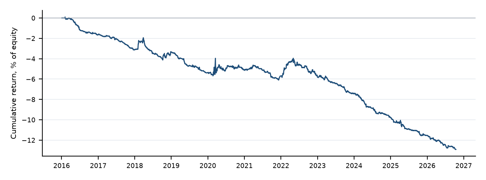

# Quantitative Day Trading Strategy: Research & Specification Report

## Executive summary

**Question.** Is there a day trading strategy, built only from price and volume, that this repository can trade (US equities and ETFs on Alpaca paper, 1-minute bars, flat by 15:55, no leverage, no futures) and that keeps a positive expectancy after realistic costs, out of sample?

**Selection.** Out of five strategy families, the best-supported candidate with a clear mechanism is **market intraday momentum**. It has two peer-reviewed papers in the *Journal of Financial Economics* (Gao, Han, Li & Zhou 2018; Baltussen, Da, Lammers & Martens 2021) and an international replication (Li, Sakkas & Urquhart 2022, *Journal of Financial Markets*). The mechanism is that short-gamma hedgers (option dealers and leveraged-ETF rebalancers) must trade in the direction of the day's move late in the session. The strategy specified here is a distinct variant of the repository's existing first-half-hour file. It uses the Baltussen et al. **rest-of-day** signal (previous close to 15:30) on SPY, QQQ and IWM. It trades only when that move exceeds half a typical daily move, enters at 15:30 and exits at 15:55. The specification was pre-registered before any data was loaded.

**Result: the strategy fails.** The test used Alpaca SIP 1-minute data from 2016-01-04 to 2026-10-15: 2,701 sessions and 4,588 trades.

- **Gross edge:** +0.55 bps per trade (t = 1.3), not statistically different from zero.
- **Net edge:** −3.0 bps per trade (t = −7.1) after spread, 1 bp slippage per side and regulatory fees.
- **Sharpe:** −1.42, with a block-bootstrap 95% interval of −2.20 to −0.81.
- **Consistency:** positive in 1 of 11 years.

The signal is no better than random direction on the same days (permutation p = 0.098). Even with measured NBBO spreads and zero slippage, the net edge is +0.04 bps. Holding to the 16:00 close as the papers do does not help: gross +0.29 bps. An independent regression shows why. Since 2016 the rest-of-day return has had no reliable relationship with the late-day return in SPY (slope t = 0.7) or IWM (t = −2.1, the wrong sign). In QQQ the relationship was present until 2022 and has been absent since 2023.

**Why it fails where the literature succeeded.** The effect the papers measured is too small after costs in this sample, and it may have weakened since publication. One candidate cause, which this study did not test, is the growth of zero-days-to-expiry (0DTE) options with dealers net long gamma. This is the same "gross-edge ceiling" failure mode that Mesfin (2026, arXiv 2605.04004) documents for 11 of 14 OHLCV signal families in MNQ futures. This study does not escape it.

**Least-bad version.** A volatility-regime gate trades only when 20-day volatility is in the top third of the last 200 sessions. Gao et al. predicted a stronger effect on volatile days, and the gate recovers a gross edge of +3.3 bps (t = 2.6). Net of pre-registered costs, however, it is still −0.2 bps per trade (Sharpe ≈ 0), and it was negative in 2024, 2025 and 2026. The gate was chosen after seeing the results, so it is in-sample.

> **Recommendation: DO NOT DEPLOY.** Do not approve either version for paper or live trading on the expectation of profit. The files are delivered because the brief requires a validated artifact. They validate, replay identically in the repository's own engine, and carry this verdict in their `assumptions`. Section 9 lists the evidence that would change the decision.

All performance figures in this report are either cited from the literature (labelled **[Lit]**, with source) or produced by this study's own script (labelled **[Own]**, with the data window and costs). The two are never mixed in one figure.

<!-- pagebreak -->

## 1. Research mandate and literature review

### 1.1 Citation verification

Every work named in the brief was searched for directly. Verification status:

| Work as named in the brief | Status | What was found |
|---|---|---|
| Handelshögskolan papers on ORB profitability across volatility states | **Verified** (Umeå School of Business, i.e. Handelshögskolan vid Umeå universitet) | Holmberg, Lönnbark & Lundström (2013), *Finance Research Letters* 10(1), 27–33; Lundström (2017), "Day trading returns across volatility states", Umeå Economic Studies 861 (working paper, not journal-published) |
| 2026 Vortex Capital study on long/short ORB asymmetry | **Exists, but not a study** | A Vortex Capital Group blog post (13 May 2026): about 20 sessions, 9 stocks, about 30 signals per side, no costs, no significance tests |
| Notre Dame paper on gamma hedging and intraday momentum | **Verified** | Baltussen, Da (Notre Dame), Lammers & Martens (2021), *JFE* 142(1), 377–403 |
| SPY intraday momentum paper (RePEc, 2024) | **Verified** | Zarattini, Aziz & Barbon (2024), "Beat the Market", Swiss Finance Institute RP 24-97, RePEc chf:rpseri:rp2497 |
| Vortex Capital "Off-Radar Reversion Illusion" | **Exists, but not peer-reviewed** | Vortex Capital Group blog post (8 July 2026); its own methodology is summarised in 1.4 |
| arXiv 2605.04004, "Structural Limits of OHLCV-Based Intraday Signals in MNQ Futures" | **Verified** (full text read) | Mesfin (2026), single-author preprint, v3 revised 15 Sep 2026; not peer-reviewed |
| Boller et al. (Duke 2025), factor-based intraday predictability | **Could not be verified under this name.** No "Boller et al." found | The closest genuine work is Aleti, Bollerslev & Siggaard (2025), "Intraday Market Return Predictability Culled from the Factor Zoo", *Management Science* 71(9), 7731–7751 (Duke). "boller" is Bollerslev's Duke faculty-database ID, which suggests a garbled citation |
| Gao, Han, Li & Zhou (2018) | **Verified** (abstract and bibliographic record) | *JFE* 129(2), 394–414 |
| Heston, Korajczyk & Sadka (2010) | **Verified** | *Journal of Finance* 65(4), 1369–1407 |
| Bogousslavsky (2016; 2021) | **Verified** | *JF* 71(6), 2967–3006; *JFE* 141(1), 172–194 |
| Zarattini, Barbon & Aziz (2024), ORB on Stocks in Play | **Verified** | SSRN 4729284 / SFI RP 24-98 |
| Novy-Marx & Velikov (2016) | **Verified** | *Review of Financial Studies* 29(1), 104–147 |
| 0DTE / gamma literature | **Partly verified** | Dim, Eraker & Vilkov (2024), SSRN 4692190: abstract read via a seminar listing; authorship from secondary listings. Adams et al. (2025) on 0DTE volatility dampening: secondary summaries only (SIFMA, Quantpedia); the primary paper was not located |

Statistics marked **[Lit]** below were read from the paper or its official abstract unless they are labelled "secondary".

### 1.2 Opening range breakout (ORB)

- **[Lit] Zarattini, Barbon & Aziz (2024).** A 5-minute ORB restricted to "Stocks in Play" (top 20 of more than 7,000 US stocks by relative volume), 2016–2023, net of costs: total return above 1,600%, Sharpe 2.81, annualised alpha 36%. A QuantConnect community replication reports Sharpe about 2.4 (secondary). These are the authors' own backtests, using up to 4× leverage and a full-market relative-volume scan.
- **[Lit] Holmberg, Lönnbark & Lundström (2013).** ORB returns significantly above zero, with a success rate above a fair game. The abstract reports no magnitudes.
- **[Lit] Lundström (2017, working paper).** ORB daily returns differ by about 150 bps per day between the highest and lowest volatility states in S&P 500 futures, and about 200 bps in crude oil. This makes ORB strongly regime-dependent.
- **[Lit] Mesfin (2026), MNQ futures 2021–2025, out-of-sample walk-forward.** ORB long with a 75-minute hold: net +2.82 points, T = 0.88, unstable across years. ORB short: net −2.16 points. ORB with a 1-bar hold: negative on both sides.
- **[Lit] Vortex Capital (2026, blog).** On about 20 sessions, the long ORB reached its target before its stop 30.6% of the time (n = 36), against 46.7% for the short (n = 30). This is too small a sample to support an "inverted asymmetry" claim.

**Assessment.** The only strong ORB evidence is cross-sectional: it depends on scanning thousands of stocks for news-driven relative volume. This repository trades a fixed watchlist and already ships `orb5_stocks_in_play_long/short.v1`. On index products, which is what Mesfin tests, ORB fails out of sample. Long/short symmetry is poor and regime-dependent.

### 1.3 Intraday momentum

- **[Lit] Gao, Han, Li & Zhou (2018).** On SPY 1993–2013, the return from the previous close to 10:00 predicts the last half hour. The effect is stronger on volatile, high-volume, recession and macro-news days, and holds in ten other ETFs. Secondary (CXO Advisory): out-of-sample R² of about 1.8% (1999–2012), and about 1.4% on 2012–2014. The paper's tests ignore trading frictions.
- **[Lit] Baltussen, Da, Lammers & Martens (2021).** In more than 60 futures from 1974 to 2020, the return from the previous close to 15:30 (r_ROD) predicts the last 30 minutes more strongly than the first half hour does, and reverts over the next days. Timing-strategy Sharpe ratios are 0.87–1.73 at the asset-class level, **before transaction costs**. The authors note that the effect is exploitable in S&P 500 futures at a cost of one tick. The mechanism is supported directly: the effect is present when option dealers' gamma is negative and strengthens as it becomes more negative, and leveraged-ETF rebalancing adds to it.
- **[Lit] Li, Sakkas & Urquhart (2022).** In 16 developed markets the effect is significant in and out of sample, and stronger when liquidity is low and volatility is high.
- **[Lit] Zarattini, Aziz & Barbon (2024), "Beat the Market".** On SPY, a "noise area" breakout with trailing stops, 2007 to early 2024, net of costs: total return 1,985%, 19.6% a year, Sharpe 1.33. The repository already ships this as `spy_noise_breakout_long/short.v1`.
- **[Lit] Counter-evidence on the mechanism.** Dim, Eraker & Vilkov (2024): high 0DTE open-interest gamma does not propagate volatility. Adams et al. (2025, secondary): 0DTE activity dampens S&P 500 volatility on average. If dealers are net long gamma in 0DTEs, their hedging trades against the day's move, which offsets the short-gamma flow that drives intraday momentum.

**Assessment.** This family has the strongest evidence: two *JFE* papers, an out-of-sample international replication, and a mechanism that has been tested directly. It survives costs only at futures-level costs in the papers' samples. Long and short sides are symmetric by construction.

### 1.4 VWAP strategies

- **[Lit] Zarattini & Aziz (2023), SSRN 4631351.** A VWAP trend rule on QQQ (long above VWAP, short below), 2018 to September 2023: +671%, Sharpe 2.1, maximum drawdown 9.4% (authors' figures). Public replications are weaker. The repository already ships `vwap_trend_long/short.v1`.
- **[Lit] Vortex Capital (2026), "The Off-Radar Reversion Illusion" (blog).** The sample was 29 mid-caps from 2026-03-02 to 2026-07-02. Measured naively, a stretched price reverts toward VWAP 72.6% of the time. Measured as a tradable trade (VWAP reached before the stop), the rate is 35.2% (n = 833, at least 2σ). Median half-spread is 15.0 bps for these names against 0.82 bps for mega-caps. Gross +1.7 bps, net −24 bps per trade. The mechanism: most of the "reversion" is VWAP drifting toward price, not price returning to VWAP.
- **Assessment.** No peer-reviewed support exists for VWAP fades. The trend version relies on the authors' own backtests and has no published out-of-sample test or significance test.

### 1.5 The falsification study: Mesfin (2026), arXiv 2605.04004

Fetched and read in full (v3).

- **Data:** MNQ front-month futures, regular trading hours only, 5-minute bars (72,604 bars, 947 days, December 2021 to August 2025), from NinjaTrader, no roll adjustment.
- **Costs:** 2.0 points round trip per trade, about 0.8–1.8 bps.
- **Design:** expanding-window walk-forward with out-of-sample years 2023, 2024 and 2025 (partial). A signal had to pass five gates: out-of-sample net t ≥ 2, at least 30 trades per fold, positive net return, the same sign in every out-of-sample year, and a permutation test.
- **The 14 families:** three ORB variants, Asia-session expansion, Asia liquidity grab, gap fill, gap continuation, volume spike, volume dry-up, three VVG (volatility-volume-gap) classifier variants counted as one group, event-day trend, and gold (MGC) mean reversion.
- **Result:** none passed. Eleven failed because the gross edge was 0.07–1.50 points per trade, below the 2-point friction floor. Three cleared friction but failed elsewhere: ORB long (T = 0.88), VVG reversal (T = 1.26, 35 trades), and gap continuation short (net +14.52 points, T = 1.46, unstable across years). The only signals that passed were two of the author's own regime-model signals with 60–75-minute holds. The author notes these were selected after evaluating at least 53 parameter combinations.
- **Caveats:** single author, not peer-reviewed. The abstract and Table 3 disagree on the permutation threshold (p < 0.05 against p < 0.001).

**Would the selected strategy survive where these failed?** The candidate was chosen because it differs from them in three ways. It is a flow-driven, clock-anchored signal with a documented counterparty, it holds for 25 minutes rather than one bar, and it runs on an instrument where round-trip cost is about 0.5–3.5 bps. **The own backtest shows that it does not survive.** Its gross edge (+0.55 bps per trade) falls in the same ceiling band as Mesfin's eleven failures. The only part that clears costs (volatile regimes, +3.3 bps gross) does so only under optimistic costs, and not in 2024–2026.

### 1.6 Factor-based intraday predictability

- **[Lit] Aleti, Bollerslev & Siggaard (2025), *Management Science*.** Lagged high-frequency returns on cross-sectional factors (the "factor zoo") predict the intraday market return. The forecasts use machine-learning regularisation and separate jumps from continuous moves. The authors report sizeable out-of-sample Sharpe ratios and alphas net of costs in liquid ETFs, concentrated in high-uncertainty periods. Specific numbers were not extracted (abstract-level verification).
- **[Lit] Heston, Korajczyk & Sadka (2010).** A stock's return in a given half-hour continues at the same half-hour on later days for at least 40 days. Volume, order imbalance, volatility and spreads do not explain it.
- **[Lit] Bogousslavsky (2016; 2021).** Infrequent rebalancing produces intraday autocorrelation and seasonality. The size and illiquidity premia are realised in the last 30 minutes, and mispricing factors reverse overnight.
- **Assessment.** The evidence is credible, but it needs intraday returns on hundreds of factor portfolios and penalised regression fitted outside the DSL. This repository cannot do it today (Section 5).

### 1.7 Transaction costs

**[Lit] Novy-Marx & Velikov (2016).** Costs always reduce anomaly profits. Strategies turning over more than 50% a month rarely survive costs. The most effective mitigation is a buy/hold spread: a stricter entry than exit. An intraday strategy turns over its whole book every day, which places it at the extreme of this taxonomy. The only intraday rules that survive have a gross edge of several basis points per trade, at the lowest-cost instruments.

### 1.8 Comparison table

| Family | Strongest evidence | Out of sample | Survives costs? | Regime dependence | Long/short | Tradable here |
|---|---|---|---|---|---|---|
| ORB, Stocks in Play | SSRN working paper (authors' backtest) | Replication only | Authors: yes | High (Lundström) | Asymmetric | Partly (watchlist only; already shipped) |
| ORB, index | FRL 2013; Mesfin 2026 | Mesfin: fails | No (MNQ) | High | Asymmetric | Yes |
| Intraday momentum (first half hour / rest of day) | Two *JFE* papers, *JFM* replication | Yes (Li et al.) | Futures at 1 tick: yes (Baltussen) | Stronger when volatile | Symmetric | Yes (ETFs) |
| SPY noise breakout | SFI working paper | No | Authors: yes | Yes | Both | Yes (already shipped) |
| VWAP trend | SSRN working paper | No | Disputed | Trend days | Both | Yes (already shipped) |
| VWAP fade | None peer-reviewed | No | No (Vortex) | n/a | Both | Yes (already shipped) |
| Factor-zoo predictability | *Management Science* 2025 | Yes | Yes (authors) | High uncertainty | Both | No (needs factor data and ML) |

### 1.9 Strategy selection and justification

**Selected: rest-of-day market intraday momentum** (Baltussen et al. 2021) on SPY, QQQ and IWM, with a volatility-scaled entry band.

- **Strongest empirical support:** two peer-reviewed *JFE* papers, a peer-reviewed international out-of-sample replication, more than 45 years of data, and a mechanism tested directly with dealer-gamma and leveraged-ETF data.
- **Clear counterparty:** short-gamma hedgers who must buy into rallies and sell into declines late in the day, regardless of price. That is non-informational, recurring flow, the kind of edge that can persist.
- **Lowest-cost instruments the system can trade:** SPY, QQQ and IWM had median NBBO spreads of 0.26, 0.28 and 0.34 bps around 15:30 and 15:55 (own measurement, last 60 sessions).
- **Distinct from what is already shipped:** it uses the rest-of-day signal, not the first half hour, and adds an explicit cost-motivated band.
- **Why not the others:** ORB on Stocks in Play needs a full-market relative-volume scan and is already shipped. Index ORB fails in Mesfin. VWAP rules lack peer-reviewed support. Factor-zoo prediction cannot be expressed in the DSL.

The selection was made on the literature alone, and the specification was fixed before any data was loaded: `reports/rod_momentum/PREREGISTRATION.md`. The one amendment, made before results existed, sets the exit price to the 15:54 bar close so that the backtest fills exactly as `core/session.py` does.

<!-- pagebreak -->

## 2. Trading system specification

Files: `strategies/rod_momentum_long.v1.yaml` and `rod_momentum_short.v1.yaml` (the pre-registered specification), and `rod_momentum_long.v2.yaml` and `rod_momentum_short.v2.yaml` (the post-hoc regime gate; not validated).

<!-- params -->
| Parameter | Value | Range in the file | Rationale |
|---|---|---|---|
| Universe | SPY, QQQ, IWM | fixed symbol list | Lowest-cost liquid index ETFs; stand-ins for ES, NQ and RTY |
| Liquidity filter | adv(20) ≥ $1,000,000,000 | $100M to $100B | Always true for these ETFs; fails closed on bad data |
| Signal | r = close / prior_close − 1 at the bar closing 15:30 | none | Baltussen et al.'s r_ROD |
| Volatility scale | vol_d(20): stdev of the last 20 daily returns | vol_n 10 to 60 (v2: 10 to 40) | Measures the move in "typical days" |
| Long entry | r > 0.5 × vol_d(20) | band_k 0 to 2 | Skips small-move days where the expected edge is below cost |
| Short entry | r < −0.5 × vol_d(20) | band_k 0 to 2 | Mirror; needs allow_short |
| Decision time | the bar closing 15:30 only (`on_interval(30)` in window 15:29–15:30) | fixed | The paper's 30 minutes before the close |
| Order | marketable limit, filled at the next bar's open (about 15:30:00), limit = decision price × (1 + 0.1%) | account control | `core/exchange.py` |
| Time exit | flatten at 15:55 (the close of the 15:54 bar) | account flatten_by | Latest the account allows; the papers hold to 16:00 |
| Protective stop | 0.5 × atr_d(14) below entry (long) or above (short), broker-side bracket | stop_atr 0.2 to 2.0 | About 0.5–0.8% of price, about 2.5σ of a 25-minute move; hit on 1.1% of trades |
| Target | entry ± 4 × stop distance | target_r 1 to 10 | Protective only; never reached in the backtest |
| v2 regime gate | vol_rank(20, 200) ≥ 0.67 | 0 to 0.9 | Top third of 20-day volatility over the last 200 sessions (post hoc) |
| Risk per trade | 0.25% nominal | account ≤ 1% | Not binding: max_position caps notional first |
| Position size | 10% of equity notional per ETF | account max_position | About $10,000 per trade on $100,000 |
| Concurrency | at most 1 per ETF, 3 in total | limits | Matches the account's max_open_positions |
| Trades per day | at most 3 | limits | One decision per ETF per day |

**Position sizing and risk.** With a stop distance of 0.5–0.8% and 10% notional, the risk per trade is about 0.05–0.08% of equity, and the worst case for three simultaneous stops is about 0.25%. That is far inside the 2% daily-loss kill switch. SPY, QQQ and IWM have daily correlations of roughly 0.8–0.95, so three same-direction trades are essentially one bet of about 30% gross notional. Do not run this strategy alongside `intraday_momentum_last_half_hour_*` or `spy_noise_breakout_*` on the same symbols: all three bet on the same afternoon move.

**Do not trade when:** the 15:30 bar is missing or stale (the feed halt is 3 minutes); history is insufficient (fewer than 21 sessions for vol_d and atr_d, 221 for the v2 gate); the session closes early (there is no 15:30 bar); the kill switch is active; or an approval arrives after the 90-second expiry (execution mode manual).

**Transaction cost assumptions** (pre-registered; per side unless stated):

| Component | Assumption | Source and realism |
|---|---|---|
| Commission | $0 | Alpaca commission-free US equities (Alpaca pricing and regulatory-fee pages) |
| SEC Section 31 fee | $20.60 per $1M sold (0.21 bps, sells only) | SEC Fee Rate Advisory FY2026, effective 4 April 2026 ($0 from 14 May 2025 to 3 April 2026; $27.80 before that) |
| FINRA TAF | $0.000195 per share sold, capped at $9.79 | 2026 rate, from broker fee pages (secondary; FINRA's own page was not fetched) |
| Half-spread | max(measured, floor): floors 0.5 bps for SPY and QQQ, 1.0 bp for IWM | Measured median full spreads of 0.26, 0.28 and 0.34 bps (own NBBO sample, 480 symbol-day-times), so the floors are conservative |
| Slippage | 1.0 bp | Covers latency between the 15:30 bar close and order arrival (REST polling) and small-order impact |
| Round trip, as modelled | about 3.55 bps | Gross edge must exceed this; a measured-only lower bound is about 0.5 bps |

The pre-registered costs are deliberately conservative. Section 3 shows that the conclusion does not depend on them: the gross edge itself is indistinguishable from zero.

<!-- pagebreak -->

## 3. Expected performance

### 3.1 Literature-reported figures [Lit]

| Source | Instrument and period | Costs | Figure |
|---|---|---|---|
| Baltussen et al. (2021), Table 6 and text | 60+ futures, 1974–2020 | None | Timing-strategy Sharpe 0.87–1.73 (asset-class level) |
| Baltussen et al. (2021), text | S&P 500 futures | 1 tick | Net Sharpe positive (no figure given) |
| Gao et al. (2018), via CXO Advisory (secondary) | SPY, 1999–2012 | None | Out-of-sample R² about 1.8% |
| Li, Sakkas & Urquhart (2022) | 16 developed markets | Not stated in the abstract | Significant in and out of sample in most countries |
| Zarattini, Aziz & Barbon (2024) | SPY, 2007 to early 2024 (a different rule) | Commission and slippage | 19.6% a year, Sharpe 1.33 |

### 3.2 Own backtest [Own]

Window: 2016-01-04 to 2026-10-15, 2,701 sessions; Alpaca SIP split-adjusted 1-minute bars; costs from Section 2. In the account view, each trade is 10% of equity. Script: `scripts/research_rod_momentum_backtest.py`; outputs: `reports/rod_momentum/`.

| Metric (primary v1, long and short) | Value |
|---|---|
| Trades | 4,588 on 2,140 of 2,701 sessions (1.7 a day, about 8.5 a week) |
| Win rate | 41.6% |
| Average win / average loss | +18.2 bps / −18.1 bps (payoff 1.00) |
| Gross per trade | +0.55 bps (t = 1.30), i.e. +$0.55 per $10,000 trade |
| Cost per trade | 3.56 bps |
| **Net per trade** | **−3.01 bps (t = −7.06), i.e. −$3.01 per $10,000 trade** |
| Profit factor | 0.72 |
| Annual return (account view, 10% per position) | −1.29% (95% bootstrap interval −1.76% to −0.79%) |
| Annual volatility | 0.90% |
| **Sharpe (daily, 252 days)** | **−1.42 (95% bootstrap interval −2.20 to −0.81)** |
| Maximum drawdown (account view) | −13.0% over 10.8 years |
| Daily-return t | −4.66 |
| Permutation p (random side, same days) | 0.098 |
| Deflated Sharpe probability (7 trials) | about 0 |

**All configurations evaluated** (each counts as a research trial):

| Configuration | Trades | Gross bps (t) | Net bps (t) | Sharpe |
|---|---|---|---|---|
| Primary: band 0.5σ, exit 15:55 | 4,588 | +0.55 (1.30) | −3.01 (−7.06) | −1.42 |
| Sign rule (band 0) | 8,001 | +0.60 (1.97) | −2.95 (−9.62) | −1.93 |
| Band 0.25σ | 6,126 | +0.63 (1.74) | −2.93 (−8.13) | −1.60 |
| Band 1.0σ | 2,413 | +0.90 (1.42) | −2.65 (−4.18) | −0.85 |
| Gao first-half-hour sign rule (as in the existing file) | 8,003 | +0.00 (0.01) | −3.55 (−11.51) | −2.42 |
| Hold to the 16:00 close (papers; not possible here) | 4,588 | +0.29 (0.57) | −1.62 (−3.21) | −0.65 |
| Post hoc v2: plus vol_rank ≥ 0.67 | 1,251 | +3.31 (2.58) | −0.23 (−0.18) | −0.03 |

**By year** (primary; net bps per trade): 2016 −4.41, 2017 −3.82, 2018 −0.56, 2019 −5.20, 2020 **+0.79**, 2021 −1.53, 2022 −0.19, 2023 −3.86, 2024 −6.23, 2025 −4.54, 2026 −4.37. Net is positive in 1 of 11 years, and at least 362 trades were made every year.

**By side:** long 2,580 trades, net −3.23 bps (t −6.48); short 2,008 trades, net −2.73 bps (t −3.72). The two sides are roughly symmetric, and both are negative.

**By symbol (gross):** QQQ +1.46 bps (t 1.88), SPY +0.37 (t 0.53), IWM −0.14 (t −0.19). Out-of-universe check, DIA: gross +0.01 bps, net −5.20 bps.

**By regime** (gross / net bps per trade):

| Regime | Trades | Gross (t) | Net (t) |
|---|---|---|---|
| Prior-day VIX < 15 | 1,511 | −0.38 (−1.01) | −3.96 (−10.49) |
| VIX 15–20 | 1,632 | −1.14 (−2.12) | −4.69 (−8.70) |
| VIX 20–30 | 1,151 | +3.00 (3.43) | −0.56 (−0.64) |
| VIX ≥ 30 | 294 | +5.19 (1.17) | +1.62 (0.36) |
| Own vol_rank calm (< 1/3) | 1,697 | +0.21 (0.49) | −3.37 (−7.95) |
| Own vol_rank middle | 1,311 | −1.22 (−2.02) | −4.79 (−7.90) |
| Own vol_rank volatile (≥ 2/3) | 1,251 | +3.31 (2.58) | −0.23 (−0.18) |

The regime pattern matches Gao et al.'s prior: the effect exists only on volatile days. Its size there (about 3–5 bps gross) is close to the round-trip costs modelled here.

**Cost sensitivity** (same trades): zero cost +0.55 bps (Sharpe 0.26); measured spread plus fees with no slippage +0.04 bps (Sharpe 0.02); pre-registered −3.01 bps (Sharpe −1.42); 2× costs −6.57 bps; 3× costs −10.13 bps. For v2: measured costs +2.80 bps (t 2.19, Sharpe 0.44); pre-registered −0.23 bps; 2× costs −3.77 bps. v2 by year: positive in 2018, 2020, 2021 and 2022; negative in 2017, 2019 and 2023–2026 (2024 −5.75, 2025 −7.78, 2026 −2.88 bps).

**Independent check (no trading logic, no costs).** An OLS regression of the 15:30-to-close return on r_ROD, over all sessions from 2016 to 2026, gives:

- SPY: slope 0.004 (t 0.70, R² 0.02%).
- QQQ: slope 0.021 (t 4.20, R² 0.65%). By period, 0.027 (t 3.7) in 2016–2019, 0.033 (t 3.1) in 2020–2022 and −0.003 (t −0.5) in 2023–2026.
- IWM: slope −0.010 (t −2.14).

These confirm that the backtest is not hiding an edge through an implementation error.

### 3.3 Realistic expectation

There is no positive expectation. **[Own]** In this window, the best honest estimate for v1 is about −3 bps per trade, a Sharpe of about −1.4 and about −1.3% a year at the account's 10% sizing. Even if live costs were as low as the measured spreads, the estimate is about zero. For v2, the estimate is about zero under pre-registered costs, at best about +2.8 bps per trade under measured costs, and negative over the last three years.

<!-- pagebreak -->

## 4. Validation methodology

**Data.** 1-minute and daily bars from Alpaca Market Data v2 on the SIP (consolidated) feed, split-adjusted only; they cover 2016-01-04 to 2026-10-15, the start of Alpaca's history. The prior close is Alpaca's daily close, the same field the repository's `daily` table stores. VIX daily closes come from Cboe's public history file and are used only for the regime split, lagged one day. NBBO quotes (SIP) were taken for the last 60 sessions, ±10 seconds around 15:30:00 and 15:55:00. Inputs are cached to `data/research/` (git-ignored). The data fingerprint is a SHA-256 hash of the cached inputs, starting `02907881d6f6a3c4`, recorded in `results.json`. Note that live paper trading uses the **IEX** feed (`ALPACA_DATA_FEED=iex`), so a live 15:29 bar can differ slightly from the SIP bar.

**Walk-forward.** Rules are fixed, so every year is out of sample relative to the papers' samples (1993–2013 and 1974–2020) and to the pre-registration. Additionally, the band k was chosen from {0, 0.25, 0.5, 1.0} each year using only prior years' net Sharpe (expanding window, first out-of-sample year 2018). It selected k = 1.0 every year. Combined out-of-sample result for 2018–2026: 2,043 trades, net −2.49 bps (t −3.40), Sharpe −0.76. It is better than the fixed k = 0.5 (Sharpe −1.24 over the same years), but still negative.

**Execution accounting.** Decisions are made at the bar close and filled at the next bar's open. The marketable limit pays the half-spread plus slippage. The broker-side bracket is active from the fill bar, with the stop assumed to fill first when the stop and target fall in the same bar. The time exit fills at the 15:54 bar close, as `core/session.py` does. Regulatory fees are charged on sells.

**Parity with the trading code.** `scripts/research_rod_momentum_parity.py` replays the YAML files through `backtest/engine.py`, which uses the same `TradingSession` and `SimExchange` as paper trading. For v1, all 4,588 of the script's trades were matched, with 0 side mismatches and median entry and exit price differences of 0.000 bps. For v2, all 1,251 were matched. The engine made 7 (v1) and 1 (v2) extra trades, all on early-close sessions where the harness fed post-close bars. Live trading clamps `flatten_by` on those days. Results: `PARITY_v1.md`, `PARITY_v2.md`.

**Pitfalls addressed:**

- **Look-ahead:** daily features use completed sessions only, and VIX is lagged one day.
- **Survivorship:** the universe is three ETFs that existed for the whole window.
- **Multiple testing:** every trial is reported, 7 in all, and a deflated Sharpe is computed.
- **Regime monoculture:** the window includes 2018, 2020 and 2022.
- **Selecting on the test set:** this happened only for v2, which is labelled post hoc and carries a "do not approve" assumption.

**Statistics:**

- per-trade t-statistics on gross and net returns
- the daily-return t-statistic over all sessions, including days without a trade
- a stationary-block bootstrap of daily returns (10,000 replications, 10-day blocks, fixed seed)
- a permutation test that randomises the side on the same days (5,000 replications)
- the deflated Sharpe (Bailey & López de Prado 2014) over the trial set
- cost stress at 2× and 3×
- at least 362 trades in every year
- falsification gates in Mesfin's style. The primary fails four of the five: net t ≥ 2, net positive, year stability (1 of 11 years positive) and permutation p < 0.05. It passes only the trade-count gate.

**Repository workspace.** To reproduce in the dashboard, open Backtesting and select `rod_momentum_long` version 1. Use dates 2016-01-04 to 2026-10-15, symbols SPY, QQQ and IWM, spread 1 bp, slippage 1 bp, latency 0, holdout 30%, cost stress on, bootstrap 1,000 and rolling window 63. The workspace records data fingerprints and every trial. It does not do walk-forward fitting or deflated Sharpe, which the script provides (see `docs/backtesting-research.md`).

<!-- pagebreak -->

## 5. Infrastructure and feature gap analysis

| Capability | Typical retail setup | This repository |
|---|---|---|
| 1. Real-time data at the required frequency | TradingView and Thinkorswim stream ticks; Python with yfinance gives delayed 1-minute bars; the Alpaca SDK streams by websocket | **Supported, 1-minute.** `services/broker/paper.py` polls Alpaca REST bars (IEX feed live, SIP for history, `services/broker/alpaca.py`); stale-feed halt after 3 minutes. Sub-minute timing would need the Alpaca websocket stream (`wss://stream.data.alpaca.markets/v2/sip` with a paid SIP plan) |
| 2. Automatic opening-range calculation | Built-in indicators | **Supported:** `or_high(n)`, `or_low(n)`, `close_at(n)` in `dsl/evaluator.py` |
| 3. Break-level execution (stop vs limit) | Stop-market or stop-limit orders | **Partial.** Entries are marketable limits after a bar close (`core/exchange.py`), so there are no resting stop-entry orders at the break level. Adding them needs an order type in `core/engine.py`, `core/exchange.py` and `services/broker/alpaca.py` (`type: stop` or `stop_limit`) |
| 4. Real-time regime filtering (VIX/ATR gate) | Manual, or a TradingView alert | **Partial.** `atr_d`, `vol_d`, `vol_rank` and `peer()` work. VIX itself is not on Alpaca; adding it needs an index feed in `config/market_inputs.yaml` (Cboe data) or a VIXY/VXX proxy through `references` |
| 5. Position sizing calculator | Spreadsheet or broker tool | **Supported:** risk-based sizing capped by max_position and the fund allocation (`core/engine.py`, lines 126–129) |
| 6. Automated stop-loss and take-profit brackets | Broker OCO orders | **Supported:** Alpaca bracket orders (`services/broker/alpaca.py`, `bracket()`), `require_bracket: true` |
| 7. End-of-day forced liquidation | Manual | **Supported:** flatten_by 15:55, clamped on early closes (`core/session.py`). Market-on-close orders are **not** supported, which costs the last 5 minutes the papers use |
| 8. Trade logging and performance tracking | Broker statements | **Supported:** hash-chained audit (`common/audit.py`), per-strategy P&L, reconciliation every minute with a kill switch on mismatch (`services/broker/main.py`) |
| 9. Walk-forward backtesting | QuantConnect and Backtrader with custom code | **Partial:** the workspace (`backtest/workspace.py`) has holdout, rolling windows, cost stress and bootstrap, but no parameter fitting or deflated Sharpe. This study's script adds both |

Missing pieces that matter for this strategy family: market-on-close exits; resting stop-entry orders; a VIX or dealer-gamma input (e.g. a gamma-exposure series from a vendor such as SqueezeMetrics, which Baltussen et al. used); and futures access (ES/NQ through a futures broker API), where the papers report net-positive results at 1-tick costs.

<!-- pagebreak -->

## 6. Improvements beyond the academic baseline

Ranked by expected edge per added degree of freedom. None is validated; each would need its own pre-registered test.

1. **Volatility-regime gate (1 parameter).** The only lever with in-sample support: gross +3.3 bps (t 2.6) in the top volatility tercile, matching Gao et al.'s prior. Implemented as v2; net ≈ 0 under conservative costs and negative in 2024–2026.
2. **Lower execution cost (0 parameters).** At measured spreads, v2 nets about +2.8 bps. Achieving this needs passive or midpoint entry at 15:30, or execution at the close, and fill-quality measurement. Note that Alpaca paper fills are simulated and will not measure this honestly.
3. **Market-on-close exit (0 parameters).** Restores the papers' full window. The backtest shows it does not rescue v1 (gross +0.29 bps), so its value is low.
4. **Dealer-gamma gate (1 parameter, new data).** The mechanism-faithful filter (Baltussen et al.: momentum is present when dealer gamma is negative). It needs a daily gamma-exposure series; it cannot be built from OHLCV.
5. **Futures implementation (outside this system).** ES/NQ at 1-tick costs is where the literature reports net profitability.
6. **Portfolio-level de-duplication (0 parameters).** Trade one ETF (QQQ had the largest gross edge, +1.46 bps) instead of three correlated ones. This cuts cost per unit of signal but was chosen after the fact.

Rejected as low edge per degree of freedom: RSI/VWAP confirmation filters, adaptive stops, and per-symbol tuned bands.

<!-- pagebreak -->

## 7. Artifacts

| Path | What it is |
|---|---|
| `strategies/rod_momentum_long.v1.yaml`, `rod_momentum_short.v1.yaml` | Pre-registered specification (validates; carries a "not recommended" assumption) |
| `strategies/rod_momentum_long.v2.yaml`, `rod_momentum_short.v2.yaml` | Post-hoc regime-gated version (validates; carries a "not recommended" assumption) |
| `scripts/research_rod_momentum_backtest.py` | Standalone backtest: download, costs, walk-forward, regimes, bootstrap, permutation, deflated Sharpe |
| `scripts/research_rod_momentum_parity.py` | Replays the YAML files through `backtest/engine.py` and compares trades |
| `reports/rod_momentum/PREREGISTRATION.md` | Specification and decision rule fixed before the data |
| `reports/rod_momentum/RESULTS.md`, `results.json`, `trades_primary.csv`, `equity_primary.csv` | Saved run output |
| `reports/rod_momentum/PARITY_v1.md`, `PARITY_v2.md` | Engine parity results |
| `reports/rod_momentum/REPORT.md`, `build_pdf.py`, `Quantitative_Day_Trading_Strategy_Report.pdf` | This report and its PDF |

To rerun the analysis:

`.venv/bin/python scripts/research_rod_momentum_backtest.py` (about 45 minutes the first time to download, then 20 seconds from cache)

`.venv/bin/python scripts/research_rod_momentum_parity.py 1` (then `2` for v2)

## 8. Verification gates

| Gate | Status |
|---|---|
| Every cited work fetched or verified; unverifiable works named | Done (Section 1.1); "Boller et al." could not be verified; three items are verified only from abstracts or secondary sources and are labelled |
| Literature and own figures kept separate | Done ([Lit] and [Own] labels; separate tables) |
| YAML files pass the loader and validator | Done: all four pass with allow_short on; the short files are correctly rejected with allow_short off (the account default) |
| Backtest script runs end to end; results saved and matched to this report | Done: `results.json` and `RESULTS.md` |
| Parameters consistent across YAML, script and report | Done; confirmed by engine parity (4,588 of 4,588 and 1,251 of 1,251 trades matched) |
| PDF renders with every section, table and disclaimer | Done (pages rendered and inspected) |
| No existing files modified; no secrets printed; no Docker or orders | Done: only new files; keys read from the environment, never printed |

## 9. Final recommendation and deployment

> **Decision: DO NOT DEPLOY.** The pre-registered decision rule required a net-positive edge with t ≥ 2, at least 30 trades a year, a majority of positive years, survival at 2× costs and a bootstrap P(Sharpe ≤ 0) below 5%. v1 fails all of these except trade count. v2 fails all of them, including trade count (5 trades in 2016, 33 in 2023), and is post hoc.

**Where the files live and how they were validated.** The files are under `strategies/`. They were validated with `dsl.validator.validate` against the factory risk controls (output in Section 8), backtested with the script and replayed through the repository engine.

**If the owner nevertheless wants a paper experiment.** Its purpose would be to measure live 15:30 fills against the model, not to earn returns.

1. Run the dashboard workspace backtest from Section 4 to put the evidence on record.
2. Choose `rod_momentum_long.v2` (long only works with the default allow_short off). Approve it for paper on the Strategies page by its hash, with execution mode manual, or paper_auto if the owner chooses.
3. Run it for at least the configured 20 paper sessions (`config/lifecycle.yaml`). Compare each fill with the 15:30 bar open and the NBBO.

Expect about zero P&L before costs. Alpaca's paper fills are simulated, so they understate real slippage.

**Before any real-money consideration**, all of the following must hold. Real money is disabled in this system regardless.

- A forward, pre-registered out-of-sample period of at least 12 months with net t ≥ 2.
- Live-measured round-trip cost of 1 bp or less.
- The edge must not depend on 2018–2022 alone.
- Independent replication of the effect after 2023.
- Owner review under the README lifecycle.

**What would change the decision:**

- dealer-gamma data showing the effect returns when gamma is negative
- futures access at 1-tick costs
- market-on-close exits combined with a regime gate that validates out of sample
- a different family with a cross-sectional universe the system cannot currently scan, such as Stocks-in-Play ORB with a full-market relative-volume screen

## References

- Aleti, S., Bollerslev, T. & Siggaard, M. (2025). Intraday Market Return Predictability Culled from the Factor Zoo. *Management Science* 71(9), 7731–7751. [scholars.duke.edu/publication/1573580](https://scholars.duke.edu/publication/1573580)
- Bailey, D. H. & López de Prado, M. (2014). The Deflated Sharpe Ratio. *Journal of Portfolio Management* 40(5), 94–107. [davidhbailey.com/dhbpapers/deflated-sharpe.pdf](https://www.davidhbailey.com/dhbpapers/deflated-sharpe.pdf)
- Baltussen, G., Da, Z., Lammers, S. & Martens, M. (2021). Hedging Demand and Market Intraday Momentum. *Journal of Financial Economics* 142(1), 377–403. [academicweb.nd.edu/~zda/intramom.pdf](https://academicweb.nd.edu/~zda/intramom.pdf)
- Bogousslavsky, V. (2016). Infrequent Rebalancing, Return Autocorrelation, and Seasonality. *Journal of Finance* 71(6), 2967–3006. [infoscience.epfl.ch/record/229415](https://infoscience.epfl.ch/record/229415?ln=en)
- Bogousslavsky, V. (2021). The Cross-Section of Intraday and Overnight Returns. *Journal of Financial Economics* 141(1), 172–194. [ideas.repec.org/a/eee/jfinec/v141y2021i1p172-194.html](https://ideas.repec.org/a/eee/jfinec/v141y2021i1p172-194.html)
- Cboe. VIX daily price history. [cdn.cboe.com/api/global/us_indices/daily_prices/VIX_History.csv](https://cdn.cboe.com/api/global/us_indices/daily_prices/VIX_History.csv)
- CXO Advisory. First and last half hours of trading linked (secondary summary of Gao et al.). [cxoadvisory.com/calendar-effects/first-and-last-half-hours-of-trading-linked](https://cxoadvisory.com/calendar-effects/first-and-last-half-hours-of-trading-linked)
- Dim, C., Eraker, B. & Vilkov, G. (2024). 0DTEs: Trading, Gamma Risk and Volatility Propagation. SSRN 4692190. Abstract via [maths.ox.ac.uk/node/67396](https://www.maths.ox.ac.uk/node/67396)
- Gao, L., Han, Y., Li, S. Z. & Zhou, G. (2018). Market Intraday Momentum. *Journal of Financial Economics* 129(2), 394–414. [profiles.wustl.edu/en/publications/market-intraday-momentum](https://profiles.wustl.edu/en/publications/market-intraday-momentum/)
- Heston, S. L., Korajczyk, R. A. & Sadka, R. (2010). Intraday Patterns in the Cross-section of Stock Returns. *Journal of Finance* 65(4), 1369–1407. [ideas.repec.org/a/bla/jfinan/v65y2010i4p1369-1407.html](https://ideas.repec.org/a/bla/jfinan/v65y2010i4p1369-1407.html)
- Holmberg, U., Lönnbark, C. & Lundström, C. (2013). Assessing the Profitability of Intraday Opening Range Breakout Strategies. *Finance Research Letters* 10(1), 27–33. [ideas.repec.org/p/hhs/umnees/0845.html](https://ideas.repec.org/p/hhs/umnees/0845.html)
- Li, Z., Sakkas, A. & Urquhart, A. (2022). Intraday Time Series Momentum: Global Evidence and Links to Market Characteristics. *Journal of Financial Markets* 57, 100619. [ideas.repec.org/a/eee/finmar/v57y2022ics138641812100001x.html](https://ideas.repec.org/a/eee/finmar/v57y2022ics138641812100001x.html)
- Lundström, C. (2017). Day Trading Returns across Volatility States. Umeå Economic Studies 861 (working paper). [swopec.hhs.se/umnees/abs/umnees0861.htm](https://swopec.hhs.se/umnees/abs/umnees0861.htm)
- Mesfin, M. (2026). Structural Limits of OHLCV-Based Intraday Momentum Signals in MNQ Futures: A Systematic Falsification Study. arXiv 2605.04004 (v3). [arxiv.org/abs/2605.04004](https://arxiv.org/abs/2605.04004)
- Novy-Marx, R. & Velikov, M. (2016). A Taxonomy of Anomalies and Their Trading Costs. *Review of Financial Studies* 29(1), 104–147. [nber.org/papers/w20721](https://www.nber.org/papers/w20721)
- Quantpedia. Do S&P500 0DTEs Options Increase Market Volatility? (secondary summary of Adams et al.). [quantpedia.com/do-sp500-0dtes-options-increase-market-volatility](https://quantpedia.com/do-sp500-0dtes-options-increase-market-volatility/)
- SEC (2026). Section 31 Transaction Fee Rate Advisory for Fiscal Year 2026. [sec.gov/rules-regulations/fee-rate-advisories/2026-2](https://www.sec.gov/rules-regulations/fee-rate-advisories/2026-2)
- Alpaca. Regulatory fees. [docs.alpaca.markets/docs/regulatory-fees](https://docs.alpaca.markets/docs/regulatory-fees)
- Vortex Capital Group (2026). ORB Statistical Framework: Why the Long-Short Asymmetry Has Inverted (blog). [vortexcapitalgroup.com/insights/opening-range-breakout-a-statistical-framework-for-active-equity-day-traders](https://www.vortexcapitalgroup.com/insights/opening-range-breakout-a-statistical-framework-for-active-equity-day-traders)
- Vortex Capital Group (2026). The Off-Radar Reversion Illusion: The 73% Fade That's Really 35% (blog). [vortexcapitalgroup.com/insights/the-off-radar-reversion-illusion-the-73-fade-thats-really-35](https://www.vortexcapitalgroup.com/insights/the-off-radar-reversion-illusion-the-73-fade-thats-really-35)
- Zarattini, C. & Aziz, A. (2023). Volume Weighted Average Price (VWAP): The Holy Grail for Day Trading Systems. SSRN 4631351. [concretumgroup.com](https://concretumgroup.com/volume-weighted-average-price-vwap-the-holy-grail-for-day-trading-systems/)
- Zarattini, C., Aziz, A. & Barbon, A. (2024). Beat the Market: An Effective Intraday Momentum Strategy for S&P500 ETF (SPY). Swiss Finance Institute RP 24-97. [ideas.repec.org/p/chf/rpseri/rp2497.html](https://ideas.repec.org/p/chf/rpseri/rp2497.html)
- Zarattini, C., Barbon, A. & Aziz, A. (2024). A Profitable Day Trading Strategy for the U.S. Equity Market. SSRN 4729284 / SFI RP 24-98. [ideas.repec.org/p/chf/rpseri/rp2498.html](https://ideas.repec.org/p/chf/rpseri/rp2498.html)

## Risk disclaimer

This research is for informational and educational purposes and is not investment advice or a solicitation to buy or sell any security.

Intraday trading carries substantial risk of loss. Simulated and historical results do not guarantee future performance. Backtests are vulnerable to overfitting, regime change and transaction-cost error.

Any strategy must be validated out of sample and run on paper before real capital is considered.

The backtest results in this report are simulated. They use historical data from Alpaca Market Data and modelled execution costs; they do not reflect actual trading. Literature figures are the original authors' results and were not independently reproduced except where stated. This report recommends against deploying the strategy it specifies.
